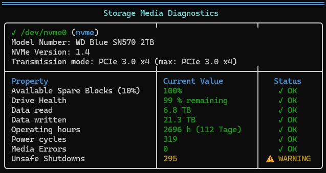

# Project Overview

**prettysmart** is a command-line tool for monitoring and analyzing SMART (Self-Monitoring, Analysis, and Reporting Technology) data from storage devices. It provides detailed information about the health status of NVMe and SATA drives in an easy-to-read format.

<p align="center">
  <a href="https://sonarcloud.io/summary/new_code?id=DocBrown101_prettysmart">
    
  </a>
</p>

<p align="center">
  
</p>

## Features

- **NVMe Support**: Comprehensive monitoring of NVMe SSDs including:
  - Estimated remaining write endurance and original percentage used (including values above 100%)
  - Available spare blocks
  - Power-on hours and cycles
  - Data units read/written
  - Media errors and error log entries
  - Thermal throttling events
  - PCIe interface information (generation and lane width)

- **SATA Support**: Monitoring of SATA drives including:
  - Reallocated sectors
  - Pending sectors
  - Offline uncorrectable sectors
  - UDMA CRC errors
  - Spin retry count
  - Reported uncorrectable errors and current/past attribute threshold failures
  - Remaining endurance and spare capacity for verified attribute/model combinations
  - Total data read/written for recognized units
  - Neutral raw and normalized values for other attributes

- **Multi-language Support**: German and English interfaces
- **Color-coded Output**: Easy-to-read status indicators with color coding for critical, warning, and normal states
- **Tabular Format**: Well-organized table display of SMART attributes
- **Change Tracking**: Shows SMART value changes compared to the previous run
- **Device Details**: Capacity, firmware and serial number

### Interpreting the results

The SMART overall status is the drive's own assessment. Estimated remaining write endurance describes wear, not overall drive health. Individual error counters and threshold failures may need attention even when the overall status passes.

ATA attribute IDs and normalized values are vendor-specific. Percentage conversion uses explicit profiles for supported Samsung, Crucial/Micron, Kingston, Intel/Solidigm and SandForce attributes. Other values retain their smartctl names and are shown without a health judgment, unless smartctl reports a threshold failure. Keep the smartmontools drive database up to date for correct attribute names and model families.

For supported Intel profiles, attribute 245 (`Percent_Life_Remaining`) uses the raw percentage, not the normalized value. Missing or out-of-range percentages remain neutral raw/normalized values.

MiB, GiB and 32 MiB counters are converted using their recognized units. Generic LBA counters are converted only for verified Samsung SSD and Crucial/Micron profiles using 512-byte accounting units, independently of the device's logical sector size. Unverified LBA counters remain raw values.

The exit status is **1** if discovery or a main device query fails, data is missing, or a protocol is unsupported. Remaining devices are still processed after individual query failures. A completed report returns **0**, including reports showing drive health warnings; the exit status is not a disk-health verdict.

## Installation

### Prerequisites

- Rust toolchain (rustc, cargo)
- `smartctl` from smartmontools package

### Building from Source

Clone the repository and build:

```bash
git clone https://github.com/DocBrown101/prettysmart.git
cd prettysmart
cargo build --release
```

The binary will be created at `target/release/prettysmart`.

## Usage

Simply run the tool (requires root privileges):

```bash
sudo ./target/release/prettysmart
```

Or install it to your PATH:

```bash
sudo cp target/release/prettysmart /usr/local/bin/
sudo prettysmart
```

## Language Selection

The tool uses the first non-empty variable in this order: `LC_ALL`, `LC_MESSAGES`, `LANG`. To force a specific language:

For German:

```bash
sudo LC_ALL=de_DE.UTF-8 ./target/release/prettysmart
```

For English:

```bash
sudo LC_ALL=en_US.UTF-8 ./target/release/prettysmart
```

## Output Example

The tool displays a table with SMART attributes for each detected storage device, including:

- Device model and interface type
- Current health status
- Value changes since the previous run
- Warning indicators (if any)
- Detailed metrics in a tabular format

## Snapshot History

prettysmart stores SMART metric snapshots per drive serial number and displays the change compared to the previous run in the Change column.

Snapshots are stored in `$XDG_STATE_HOME/prettysmart/snapshots.json`, or `$HOME/.local/state/prettysmart/snapshots.json` when `XDG_STATE_HOME` is unset. With `sudo`, these usually belong to root.

Failed main queries do not replace the last valid snapshot. Existing history remains readable. Corrected SATA hour, endurance and transfer metrics use new keys to avoid comparing incompatible meanings or units; their first new measurement shows `-` in the Change column. Decreasing pending/offline sector counts are displayed as negative changes, not counter resets.

## Build Commands

### Format Code

```bash
cargo fmt
```

### Lint Code

```bash
cargo clippy --all-targets --all-features
```

### Run Tests

```bash
cargo tests
```

### Build Release

```bash
cargo build --release
```

## Supported Devices

- NVMe SSDs (via `/dev/nvme*`)
- SATA drives (via `/dev/sd*`, `/dev/hd*`)
